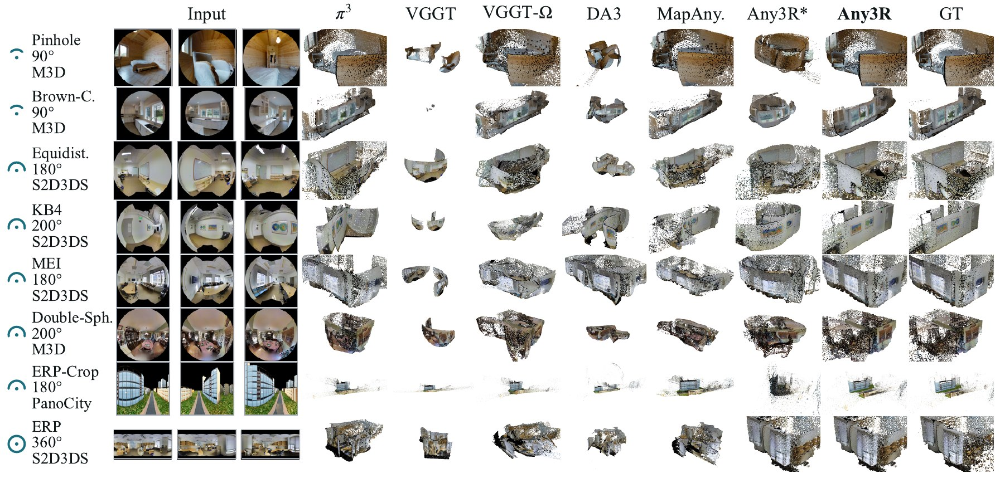
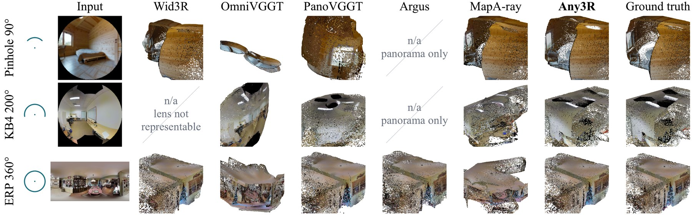
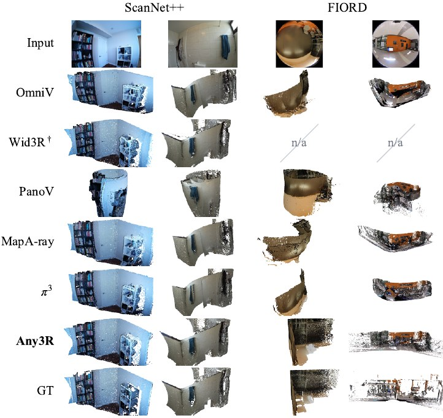

<div align="center">

# Any3R: Feedforward 3D Reconstruction from Any Camera Type

**Jingong Chen**<sup>1,2</sup> · **Qingwen Zhang**<sup>3†</sup> · **Youming Deng**<sup>4†</sup> · **Chulwoo Pack**<sup>1</sup> · **Olaf Wysocki**<sup>5</sup> · **Boris Jutzi**<sup>6</sup> · **Kwanghee Won**<sup>1*</sup> · **Kyle Gao**<sup>2</sup>

<sup>1</sup>South Dakota State University &nbsp; <sup>2</sup>Aalto University &nbsp; <sup>3</sup>KTH Royal Institute of Technology<br>
<sup>4</sup>Cornell University &nbsp; <sup>5</sup>University of Cambridge &nbsp; <sup>6</sup>Karlsruhe Institute of Technology<br>
<sup>†</sup>Equal contribution &nbsp; <sup>*</sup>Corresponding author

<a href="https://jingong-chen.github.io/Any3R/"></a> <a href="https://arxiv.org/abs/2610.36150"></a> <a href="https://huggingface.co/Jingong/Any3R"></a> <a href="LICENSE"></a> <a href="LICENSE-FAIR"></a>


</div>

**Any3R** reconstructs a scene from images taken with **any central camera**, in a single forward pass: pinhole and distorted lenses, fisheyes beyond 180°, 360° panoramas, and any mix of them in one scene. Each view is described by its **ray field**, the direction of every pixel, instead of a lens type, so one set of weights covers every lens with no undistortion and no retraining. Any3R predicts per-view depth along each ray, camera poses and a fused point cloud.

## News

- **2026-10-31** · Inference code, model weights, interactive demo and evaluation code are released.

## Contents

[Highlights](#highlights) · [Installation](#installation) · [Quick start](#quick-start) · [Cameras](#describing-cameras) · [Demos](#demos) · [Model](#model) · [Results](#results) · [Evaluation](#evaluation) · [Limitations](#limitations) · [Citation](#citation)

## Highlights

- **One model for every central camera.** Thirteen camera models are built in (pinhole, Brown–Conrady, Kannala–Brandt, equidistant, equisolid, stereographic, FOV, MEI, double sphere, EUCM, cylindrical, equirectangular and equirectangular windows), and any other central camera works through its ray field.
- **Mixed cameras in one scene.** Views from different cameras, with different sizes and fields of view, are reconstructed together into one consistent point cloud.
- **Calibrations as you have them.** COLMAP models, OpenCV calibrations, a JSON file, or just "a 190° fisheye".
- **Fast.** 32 views at 512 × 512 in 1.1 s and 128 views in 9 s (17.7 GB) on one RTX 5090.

<p align="center"></p>

The ray field enters the network in two places. *Angular coordinates* give the rotary position embedding the measured elevation and azimuth of every patch, per view, in place of its row and column; *solid-angle weighting* scales the training loss by the area each pixel covers on the sphere. Neither depends on the lens.

## Installation

```bash
git clone https://github.com/Jingong-Chen/Any3R.git
cd Any3R
conda create -n any3r python=3.11 -y && conda activate any3r
pip install torch torchvision --index-url https://download.pytorch.org/whl/cu128   # pick the build for your CUDA
pip install -e .              # the any3r package
pip install -e ".[demo]"      # optional: Gradio demo and GLB export
```

The weights (4.6 GB) are downloaded from Hugging Face on first use. A GPU with bfloat16 support is recommended; inference also runs in float16 on older GPUs and on the CPU.

## Quick start

```python
import torch
from any3r import Any3R, cameras
from any3r.io import prepare_views

model = Any3R.from_pretrained("Jingong/Any3R").to("cuda").eval()

images = ["phone.jpg", "fisheye.jpg", "panorama.jpg"]
cams = [
    cameras.from_fov("pinhole", 4032, 3024, fov_deg=55),                 # any calibration works, see below
    cameras.from_colmap("OPENCV_FISHEYE", 1920, 1920, [fx, fy, cx, cy, k1, k2, k3, k4]),
    cameras.ERP(),                                                        # equirectangular 360° panorama
]
views = prepare_views(images, cams, size=512)    # resize, compute ray maps, put the views on one canvas

pred = model.infer(views.images, views.rays)     # bfloat16 autocast inside
pred["depth"]          # (S, H, W, 1)  distance along each pixel's ray
pred["depth_conf"]     # (S, H, W)     confidence
pred["camera_poses"]   # (S, 4, 4)     camera-to-world, in the frame of the first view
pred["world_points"]   # (S, H, W, 3)  fused points; the scale is arbitrary
```

`model.infer` takes the images `(S, 3, H, W)` in [0, 1] and the ray maps `(S, H, W, 3)`, so you can also pass ray fields computed by your own code. `any3r.export.save_predictions(out_dir, pred, views)` writes a PLY point cloud, a GLB scene with the cameras, the poses as JSON and the depth maps.

## Describing cameras

Any3R needs the ray field of every view, which `any3r.cameras` computes from a calibration:

| You have | Use |
|:---|:---|
| a COLMAP sparse model | `cameras.read_colmap_cameras("sparse/0")` or `demo.py --colmap sparse/0` |
| an OpenCV calibration | `cameras.from_opencv(K, dist, W, H)`, with `fisheye=True` for `cv2.fisheye` |
| model parameters | `cameras.KB4(fx, fy, cx, cy, k1, k2, k3, k4)`, `cameras.DoubleSphere(...)`, ... |
| only the lens type and field of view | `cameras.from_fov("equidistant", W, H, fov_deg=190)` |
| an equirectangular panorama | `cameras.ERP()` |
| your own ray directions | pass them to `model.infer` directly |

Conventions, the JSON format used by the demos and the parameters of every model are in **[docs/cameras.md](docs/cameras.md)**.

## Demos

**Command line.** Three example scenes ship with the code:

```bash
# 20 views of a street through 8 different camera models (pinhole to 360°)
python demo.py --images examples/street_mixed/images --cameras examples/street_mixed/cameras.json --out outputs/street

# a real 214° fisheye with its COLMAP calibration (FIORD)
python demo.py --images examples/fiord_meetingroom/images --cameras examples/fiord_meetingroom/cameras.json --out outputs/fiord

# eight equirectangular panoramas
python demo.py --images examples/panocity_erp/images --camera erp --out outputs/panos

# your own data
python demo.py --images my_scene/images --colmap my_scene/sparse/0
python demo.py --images my_fisheye_folder --camera equidistant --fov 190
```

Each run writes `points.ply`, `scene.glb` (points and cameras), `cameras.json` (poses and calibrations) and `depth.npz`.

**Interactive.** `python demo_gradio.py` opens a browser app: upload images, pick a camera model or upload a calibration, and inspect the point cloud, cameras and depth maps. The examples load with one click.

## Model

| Model | Parameters | Input | Weights |
|:---|:---:|:---|:---|
| Any3R | 1.15 B | any number of views from any central cameras, mixed freely | [🤗 Jingong/Any3R](https://huggingface.co/Jingong/Any3R) |

Any3R is fine-tuned from VGGT-Omega for 40 epochs on Matterport3D, Stanford2D3DS, Structured3D, PanoCity and DL3DV videos. Half of the panoramic training samples are native panoramas and half are views resampled through a random camera, drawn from eight central models (pinhole, Brown–Conrady, equidistant, Kannala–Brandt, MEI, double sphere, equirectangular and cropped equirectangular) with fields of view from 30° to 360°. All test scenes are held out.

## Results

All numbers are from the paper. The benchmark images every scene of three datasets through the same views with each camera model, and every method fuses its points with **its own predicted camera poses**. Acc (m, lower is better) is the mean distance from a reconstructed point to the ground truth; AUC@15° / AUC@30° (%, higher is better) is the area under the pairwise pose-error curve. In each table, the best value of a column is in **bold** and the second best <ins>underlined</ins>. The five held-out camera models are in the paper's appendix and in [eval/README.md](eval/README.md).

### Eight camera models, seven methods

<p align="center"></p>

One scene per row, each imaged by three views through one camera model. Every method fuses the same three views with its own predicted poses and is placed in the ground-truth frame by one similarity transform; the highest 30% of each indoor cloud is removed so the room can be seen from above. MapAny. is MapAnything and Any3R\* is Any3R without its ray map. The same data can be explored in 3D on the [project page](https://jingong-chen.github.io/Any3R/#compare).

### Methods built for other cameras

<p align="center"></p>

One scene per row and camera model. Wid3R receives the true ray field, Argus takes panoramas only, and n/a marks cameras a method cannot take.

### Real fisheye lenses, zero-shot

<p align="center"></p>

ScanNet++ (DSLR fisheye) and FIORD (200° lens), neither in Any3R's training data. The samples shown are those on which Any3R leads the most; the averages over all samples are in the zero-shot table below.

### Benchmark tables

**Comparison with methods built for other cameras.** Wid3R receives the true ray field; MapA-ray is MapAnything with the true ray field fed to its ray encoder; – marks cameras a method cannot take.

<b>Indoor (Matterport3D + Stanford2D3DS)</b>

| Method | Pin. 90° | B–C 90° | Equi. 180° | ERP-C 180° | MEI 180° | KB4 200° | DS 200° | ERP 360° |
|:---|:---:|:---:|:---:|:---:|:---:|:---:|:---:|:---:|
| *Acc ↓ (m)* | | | | | | | | |
| OmniVGGT | 0.250 | 0.201 | 0.326 | 0.318 | 0.329 | 0.355 | 0.350 | 0.406 |
| Wid3R | 0.144 | – | <ins>0.141</ins> | – | <ins>0.146</ins> | – | – | 0.101 |
| PanoVGGT | 0.282 | 0.272 | 0.259 | 0.348 | 0.265 | <ins>0.251</ins> | 0.265 | <ins>0.072</ins> |
| Argus | – | – | – | – | – | – | – | 0.094 |
| MapA-ray | <ins>0.092</ins> | <ins>0.146</ins> | 0.277 | <ins>0.254</ins> | 0.239 | 0.274 | <ins>0.258</ins> | 0.405 |
| **Any3R** | **0.076** | **0.091** | **0.058** | **0.052** | **0.059** | **0.056** | **0.060** | **0.054** |
| *AUC@15° ↑ (%)* | | | | | | | | |
| OmniVGGT | 6.3 | 1.8 | 1.9 | 12.1 | 0.6 | 0.9 | 2.9 | 0.7 |
| Wid3R | 46.4 | – | <ins>59.4</ins> | – | <ins>59.5</ins> | – | – | 85.3 |
| PanoVGGT | 2.2 | 2.5 | 21.7 | <ins>21.5</ins> | 23.6 | <ins>36.2</ins> | <ins>46.9</ins> | <ins>89.2</ins> |
| Argus | – | – | – | – | – | – | – | 88.4 |
| MapA-ray | <ins>53.6</ins> | <ins>31.2</ins> | 10.4 | 6.5 | 15.5 | 12.4 | 12.0 | 4.1 |
| **Any3R** | **74.8** | **64.8** | **90.6** | **86.0** | **90.5** | **81.2** | **80.5** | **94.5** |
| *AUC@30° ↑ (%)* | | | | | | | | |
| OmniVGGT | 13.9 | 5.4 | 6.6 | 26.2 | 5.4 | 4.8 | 7.0 | 4.1 |
| Wid3R | 67.0 | – | <ins>76.4</ins> | – | <ins>76.4</ins> | – | – | 89.0 |
| PanoVGGT | 10.1 | 11.8 | 50.1 | <ins>42.6</ins> | 52.2 | <ins>63.5</ins> | <ins>69.7</ins> | <ins>93.2</ins> |
| Argus | – | – | – | – | – | – | – | 91.3 |
| MapA-ray | <ins>72.8</ins> | <ins>55.5</ins> | 25.5 | 19.7 | 34.9 | 30.2 | 32.8 | 14.1 |
| **Any3R** | **85.0** | **78.3** | **93.9** | **91.6** | **94.6** | **89.6** | **88.5** | **96.6** |

<b>Outdoor (PanoCity)</b>

| Method | Pin. 90° | B–C 90° | Equi. 180° | ERP-C 180° | MEI 180° | KB4 200° | DS 200° | ERP 360° |
|:---|:---:|:---:|:---:|:---:|:---:|:---:|:---:|:---:|
| *Acc ↓ (m)* | | | | | | | | |
| OmniVGGT | 2.875 | 2.676 | 3.313 | 2.804 | 3.703 | 3.941 | 3.670 | 1.479 |
| Wid3R | 2.278 | – | <ins>2.121</ins> | – | 2.252 | – | – | 2.330 |
| PanoVGGT | 2.256 | 2.708 | 2.498 | 3.633 | 2.433 | <ins>2.405</ins> | <ins>2.473</ins> | <ins>0.751</ins> |
| Argus | – | – | – | – | – | – | – | 1.517 |
| MapA-ray | <ins>1.484</ins> | <ins>1.558</ins> | 2.368 | <ins>2.686</ins> | <ins>2.029</ins> | 2.523 | 2.579 | 1.894 |
| **Any3R** | **1.160** | **1.243** | **0.866** | **0.811** | **0.854** | **0.863** | **0.901** | **0.663** |
| *AUC@15° ↑ (%)* | | | | | | | | |
| OmniVGGT | 1.9 | 0.7 | 3.7 | 8.5 | 3.2 | 3.1 | 5.4 | 4.2 |
| Wid3R | 8.1 | – | 25.5 | – | 22.9 | – | – | 0.0 |
| PanoVGGT | 10.8 | 10.1 | <ins>37.5</ins> | <ins>42.0</ins> | <ins>38.1</ins> | <ins>51.0</ins> | <ins>58.6</ins> | <ins>93.5</ins> |
| Argus | – | – | – | – | – | – | – | 81.9 |
| MapA-ray | <ins>56.3</ins> | <ins>45.0</ins> | 17.5 | 10.0 | 27.8 | 15.1 | 20.0 | 2.1 |
| **Any3R** | **61.5** | **51.0** | **85.0** | **87.4** | **85.2** | **79.5** | **81.0** | **97.2** |
| *AUC@30° ↑ (%)* | | | | | | | | |
| OmniVGGT | 9.6 | 4.8 | 9.0 | 19.3 | 9.3 | 10.2 | 13.2 | 6.1 |
| Wid3R | 22.8 | – | 47.9 | – | 42.6 | – | – | 0.0 |
| PanoVGGT | 25.2 | 25.9 | <ins>61.0</ins> | <ins>62.7</ins> | <ins>62.0</ins> | <ins>73.9</ins> | <ins>78.2</ins> | <ins>96.8</ins> |
| Argus | – | – | – | – | – | – | – | 90.5 |
| MapA-ray | <ins>74.7</ins> | <ins>61.6</ins> | 33.3 | 23.1 | 49.4 | 31.9 | 39.4 | 6.3 |
| **Any3R** | **80.7** | **74.2** | **92.5** | **93.7** | **92.6** | **89.4** | **90.5** | **98.6** |

**Comparison with geometry foundation models.** Any3R\* is Any3R without its ray map (it then assumes an equirectangular grid) and is not ranked.

<b>Indoor (Matterport3D + Stanford2D3DS)</b>

| Method | Pin. 90° | B–C 90° | Equi. 180° | ERP-C 180° | MEI 180° | KB4 200° | DS 200° | ERP 360° |
|:---|:---:|:---:|:---:|:---:|:---:|:---:|:---:|:---:|
| *Acc ↓ (m)* | | | | | | | | |
| π³ | <ins>0.084</ins> | <ins>0.119</ins> | <ins>0.171</ins> | 0.287 | <ins>0.164</ins> | <ins>0.189</ins> | <ins>0.183</ins> | 0.414 |
| MapAnything | 0.092 | 0.149 | 0.273 | 0.269 | 0.267 | 0.283 | 0.294 | <ins>0.386</ins> |
| DA3 | 0.313 | 0.294 | 0.361 | 0.288 | 0.363 | 0.396 | 0.379 | 0.402 |
| VGGT | 0.270 | 0.282 | 0.361 | 0.274 | 0.379 | 0.356 | 0.374 | 0.398 |
| VGGT-Ω | 0.149 | 0.161 | 0.252 | <ins>0.265</ins> | 0.250 | 0.281 | 0.302 | 0.403 |
| Any3R\* | 0.282 | 0.283 | 0.274 | 0.278 | 0.278 | 0.279 | 0.298 | 0.054 |
| **Any3R** | **0.076** | **0.091** | **0.058** | **0.052** | **0.059** | **0.056** | **0.060** | **0.054** |
| *AUC@15° ↑ (%)* | | | | | | | | |
| π³ | **76.9** | <ins>53.5</ins> | <ins>42.1</ins> | 18.0 | <ins>43.1</ins> | <ins>35.2</ins> | <ins>34.6</ins> | 3.5 |
| MapAnything | 53.6 | 28.5 | 13.2 | 9.0 | 10.8 | 8.8 | 8.4 | 6.4 |
| DA3 | 7.8 | 2.7 | 0.9 | <ins>22.1</ins> | 1.2 | 0.4 | 0.7 | <ins>7.0</ins> |
| VGGT | 23.3 | 9.9 | 5.2 | 14.2 | 5.3 | 5.0 | 2.9 | 3.3 |
| VGGT-Ω | 63.5 | 50.4 | 31.3 | 15.0 | 29.6 | 24.0 | 19.5 | 6.9 |
| Any3R\* | 24.0 | 43.8 | 48.3 | 41.7 | 48.2 | 55.0 | 58.5 | 94.5 |
| **Any3R** | <ins>74.8</ins> | **64.8** | **90.6** | **86.0** | **90.5** | **81.2** | **80.5** | **94.5** |
| *AUC@30° ↑ (%)* | | | | | | | | |
| π³ | <ins>82.7</ins> | 66.0 | <ins>61.9</ins> | 37.1 | <ins>62.7</ins> | <ins>56.4</ins> | <ins>58.9</ins> | 14.1 |
| MapAnything | 72.8 | 52.3 | 31.3 | 23.2 | 29.6 | 27.6 | 24.8 | 16.2 |
| DA3 | 17.8 | 10.3 | 5.7 | <ins>46.2</ins> | 7.2 | 5.5 | 5.1 | 16.8 |
| VGGT | 50.0 | 25.6 | 18.8 | 32.2 | 16.6 | 16.4 | 13.9 | 10.6 |
| VGGT-Ω | 76.9 | <ins>69.7</ins> | 53.8 | 34.6 | 52.3 | 47.1 | 42.0 | <ins>17.8</ins> |
| Any3R\* | 47.5 | 66.2 | 71.3 | 65.8 | 72.0 | 75.9 | 77.5 | 96.6 |
| **Any3R** | **85.0** | **78.3** | **93.9** | **91.6** | **94.6** | **89.6** | **88.5** | **96.6** |

<b>Outdoor (PanoCity)</b>

| Method | Pin. 90° | B–C 90° | Equi. 180° | ERP-C 180° | MEI 180° | KB4 200° | DS 200° | ERP 360° |
|:---|:---:|:---:|:---:|:---:|:---:|:---:|:---:|:---:|
| *Acc ↓ (m)* | | | | | | | | |
| π³ | <ins>1.479</ins> | 1.711 | 2.093 | <ins>2.426</ins> | <ins>2.036</ins> | <ins>2.394</ins> | <ins>2.271</ins> | <ins>1.628</ins> |
| MapAnything | 1.485 | 1.633 | <ins>2.066</ins> | 2.861 | 2.236 | 3.297 | 2.789 | 1.833 |
| DA3 | 4.360 | 5.689 | 6.656 | 2.717 | 6.844 | 6.463 | 6.477 | 3.149 |
| VGGT | 4.153 | 3.940 | 6.296 | 3.078 | 6.886 | 6.623 | 6.430 | 1.902 |
| VGGT-Ω | 1.711 | <ins>1.572</ins> | 2.162 | 2.455 | 2.490 | 2.680 | 2.544 | 1.876 |
| Any3R\* | 2.079 | 2.525 | 2.370 | 3.324 | 2.463 | 2.420 | 2.552 | 0.663 |
| **Any3R** | **1.160** | **1.243** | **0.866** | **0.811** | **0.854** | **0.863** | **0.901** | **0.663** |
| *AUC@15° ↑ (%)* | | | | | | | | |
| π³ | 44.6 | 34.0 | 18.8 | <ins>15.9</ins> | <ins>20.0</ins> | 14.4 | <ins>16.0</ins> | 2.3 |
| MapAnything | <ins>56.5</ins> | 20.6 | <ins>19.6</ins> | 10.6 | 17.1 | <ins>16.9</ins> | 13.8 | 0.1 |
| DA3 | 4.8 | 3.0 | 6.4 | 7.7 | 4.9 | 3.4 | 4.6 | <ins>5.5</ins> |
| VGGT | 15.1 | 2.6 | 3.7 | 9.5 | 6.5 | 5.5 | 7.3 | 0.9 |
| VGGT-Ω | 45.5 | <ins>44.4</ins> | 15.8 | 8.1 | 15.6 | 13.8 | 8.8 | 3.9 |
| Any3R\* | 20.1 | 36.0 | 45.0 | 29.9 | 47.3 | 48.8 | 50.1 | 97.2 |
| **Any3R** | **61.5** | **51.0** | **85.0** | **87.4** | **85.2** | **79.5** | **81.0** | **97.2** |
| *AUC@30° ↑ (%)* | | | | | | | | |
| π³ | 61.7 | 47.1 | 36.1 | <ins>28.3</ins> | 37.3 | 30.0 | <ins>35.0</ins> | 4.8 |
| MapAnything | <ins>74.8</ins> | 36.1 | <ins>41.9</ins> | 25.0 | <ins>39.7</ins> | <ins>34.2</ins> | 30.1 | 3.1 |
| DA3 | 13.6 | 11.5 | 14.8 | 22.1 | 10.2 | 9.8 | 10.6 | <ins>11.3</ins> |
| VGGT | 32.8 | 11.0 | 8.8 | 24.3 | 13.9 | 13.2 | 17.3 | 3.5 |
| VGGT-Ω | 55.3 | <ins>54.7</ins> | 33.8 | 23.6 | 34.8 | 31.4 | 24.4 | 8.5 |
| Any3R\* | 38.9 | 58.3 | 67.7 | 53.7 | 69.6 | 72.3 | 72.2 | 98.6 |
| **Any3R** | **80.7** | **74.2** | **92.5** | **93.7** | **92.6** | **89.4** | **90.5** | **98.6** |

**Zero-shot on real fisheye lenses:** the ScanNet++ DSLR fisheye (validation split) and the 200° lens of the FIORD rig, neither in Any3R's training data. † Wid3R is trained on ScanNet++. Any3R\* is not ranked.

| Method | ScanNet++ Acc ↓ | AUC@15° ↑ | AUC@30° ↑ | FIORD Acc ↓ | AUC@15° ↑ | AUC@30° ↑ |
|:---|:---:|:---:|:---:|:---:|:---:|:---:|
| OmniVGGT | 0.097 | 18.6 | 41.5 | <ins>0.363</ins> | 18.6 | 40.3 |
| Wid3R† | **0.039** | **85.3** | **92.6** | – | – | – |
| PanoVGGT | 0.277 | 1.8 | 9.7 | 0.511 | <ins>29.4</ins> | <ins>51.2</ins> |
| MapA-ray | 0.093 | 18.5 | 43.6 | 0.396 | 19.4 | 36.5 |
| π³ | 0.086 | 20.6 | 46.6 | 0.378 | 15.7 | 36.7 |
| MapAnything | 0.099 | 19.3 | 40.2 | 0.399 | 17.7 | 37.2 |
| DA3 | 0.118 | 17.2 | 41.5 | 0.380 | 9.1 | 25.8 |
| VGGT | 0.118 | 18.0 | 41.7 | 0.442 | 15.6 | 35.3 |
| VGGT-Ω | 0.112 | 16.7 | 42.9 | 0.451 | 19.9 | 38.9 |
| Any3R\* | 0.273 | 7.5 | 22.9 | 0.480 | 28.3 | 47.5 |
| **Any3R** | <ins>0.055</ins> | <ins>62.7</ins> | <ins>79.7</ins> | **0.274** | **63.8** | **78.4** |

## Evaluation

[`eval/`](eval/README.md) reproduces the paper's benchmark end to end: it rebuilds the 936 scene files from the original datasets (every array is checked against a frozen manifest), renders each view through its camera model, runs Any3R and computes the paper's metrics (Acc, Comp, NC, and pose AUC with predicted poses).

```bash
pip install -r eval/requirements.txt
python eval/build_benchmark.py --out data/any3r_bench --m3d-root ... --s2d3ds-root ... --panocity-root ...
python eval/evaluate.py --benchmark data/any3r_bench --out results/any3r --verify
python eval/make_table.py --results results/any3r --compare-paper
```

On the paper's configuration (A100, PyTorch 2.5.1) the released code and weights reproduce every per-scene result of the paper exactly; on other GPUs bfloat16 kernels shift the numbers slightly (on an RTX 5090, at most 0.004 m Acc and 0.7 AUC points in the main table). The full benchmark takes about 5 minutes on one RTX 5090.

## Limitations

- **Central cameras.** Every pixel's ray must pass through one centre. Non-central optics (rolling-shutter motion, push-broom sensors, strongly non-central catadioptric systems) are outside the model.
- **A calibration is needed.** Any3R uses the ray field it is given and does not estimate intrinsics. Without a calibration, `from_fov` with the nominal lens type and field of view is a reasonable start.
- **Scale and dynamics.** Reconstructions have an arbitrary scale, and the scene is assumed static.

## Citation

```bibtex
@article{chen2026any3r,
  title   = {Any3R: Feedforward 3D Reconstruction from Any Camera Type},
  author  = {Chen, Jingong and Zhang, Qingwen and Deng, Youming and Pack, Chulwoo and
             Wysocki, Olaf and Jutzi, Boris and Won, Kwanghee and Gao, Kyle},
  journal = {arXiv preprint arXiv:2610.36150},
  year    = {2026}
}
```

## Acknowledgments

Any3R builds on the code and models of [VGGT-Omega](https://github.com/facebookresearch/vggt-omega), [VGGT](https://github.com/facebookresearch/vggt) and [PanoVGGT](https://github.com/YijingGuo-June/PanoVGGT), whose authors also released the [PanoCity](https://huggingface.co/datasets/YijingGuo/PanoCity) dataset. We train on [Matterport3D](https://niessner.github.io/Matterport/) (with the panoramas stitched by [360MonoDepth](https://github.com/manurare/360monodepth)), [Stanford2D3DS](https://github.com/alexsax/2D-3D-Semantics), [Structured3D](https://structured3d-dataset.org/), PanoCity and [DL3DV](https://dl3dv-10k.github.io/DL3DV-10K/), and evaluate zero-shot on [ScanNet++](https://kaldir.vc.in.tum.de/scannetpp/) and [FIORD](https://zenodo.org/records/15181976). We thank the authors of [π³](https://github.com/yyfz/Pi3), [MapAnything](https://github.com/facebookresearch/map-anything), [Depth Anything 3](https://github.com/ByteDance-Seed/Depth-Anything-3), [OmniVGGT](https://github.com/Livioni/OmniVGGT-official), [Wid3R](https://github.com/jdk9405/Wid3R) and [Argus](https://github.com/realsee-developer/Argus) for releasing the code we compare against. The evaluation uses [Open3D](https://www.open3d.org/), and the project page is adapted from [Nerfies](https://github.com/nerfies/nerfies.github.io). The example scenes come from PanoCity and FIORD.

This work was supported by the U.S. National Science Foundation under Grant No. 2316400 and by the Wallenberg AI, Autonomous Systems and Software Program (WASP) funded by the Knut and Alice Wallenberg Foundation. The computations and data handling were enabled by the Arrhenius HPC resource provided by the National Academic Infrastructure for Supercomputing in Sweden, and by the South Dakota State University High Performance Computing (SDSU HPC) team.

## License

The code in this repository is released under the [MIT License](LICENSE), with one exception: the network trunk derived from VGGT-Omega (`any3r/_vggt_omega/` and `any3r/aggregator.py`) is, together with the model weights, under the [FAIR Noncommercial Research License](LICENSE-FAIR) inherited from VGGT-Omega. Running the Any3R model therefore means accepting that license (noncommercial research use), while the camera models, input and export utilities, demos and evaluation code can be reused under MIT on their own. Parts adapted from PanoVGGT are under the MIT License, and the example images keep their dataset licenses; see [THIRD_PARTY_NOTICES.md](THIRD_PARTY_NOTICES.md).
